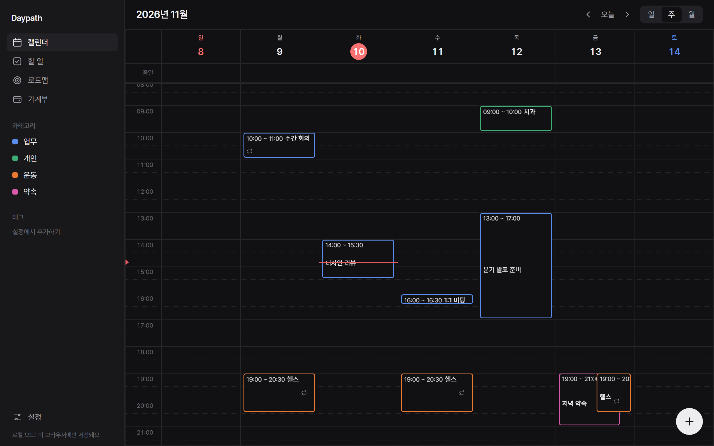
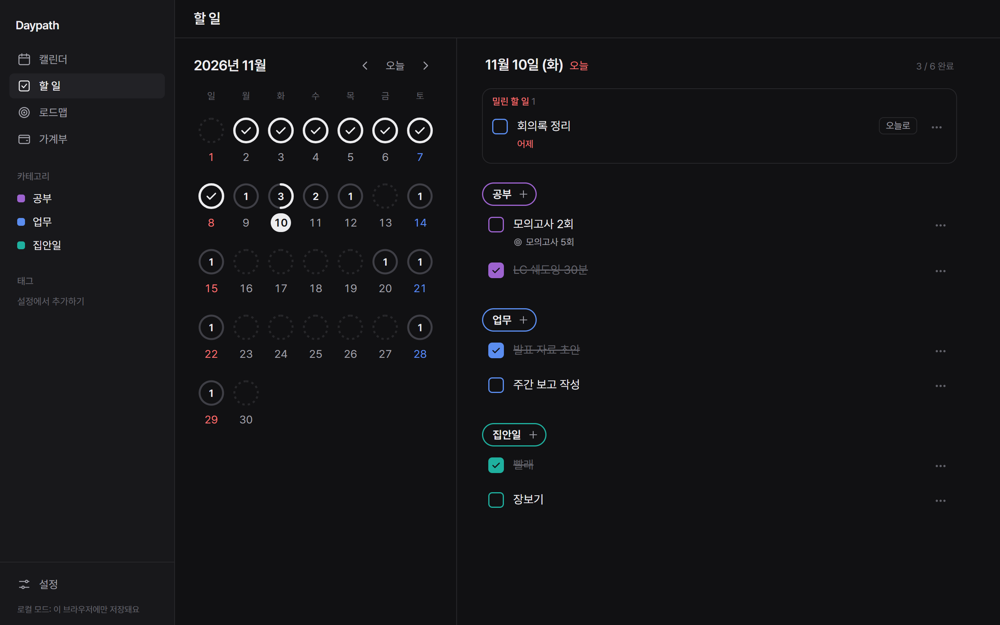
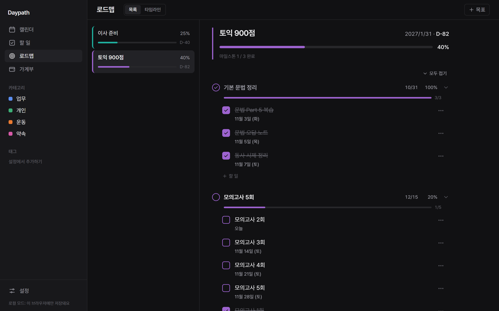
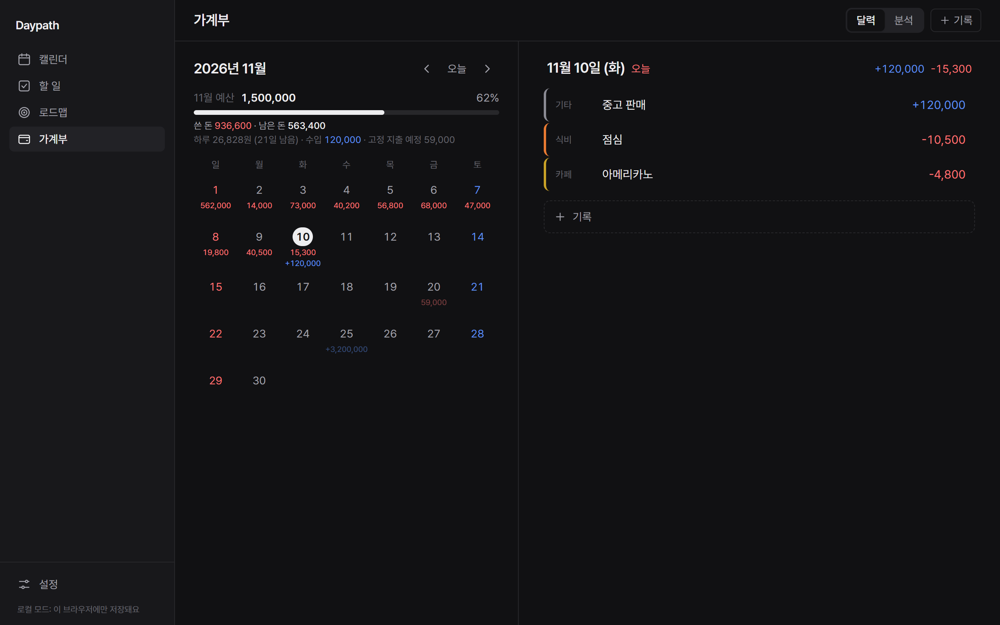
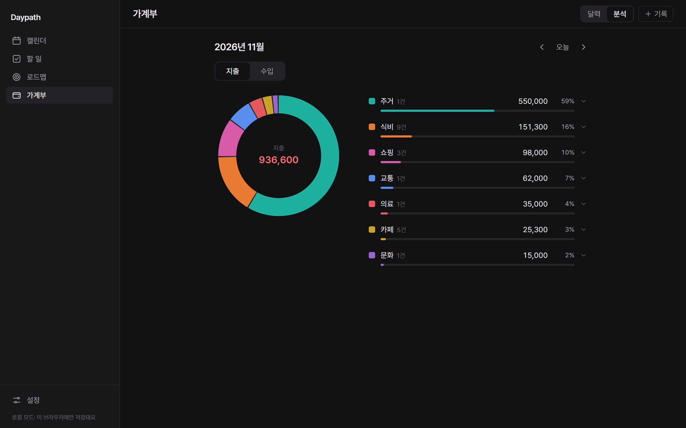
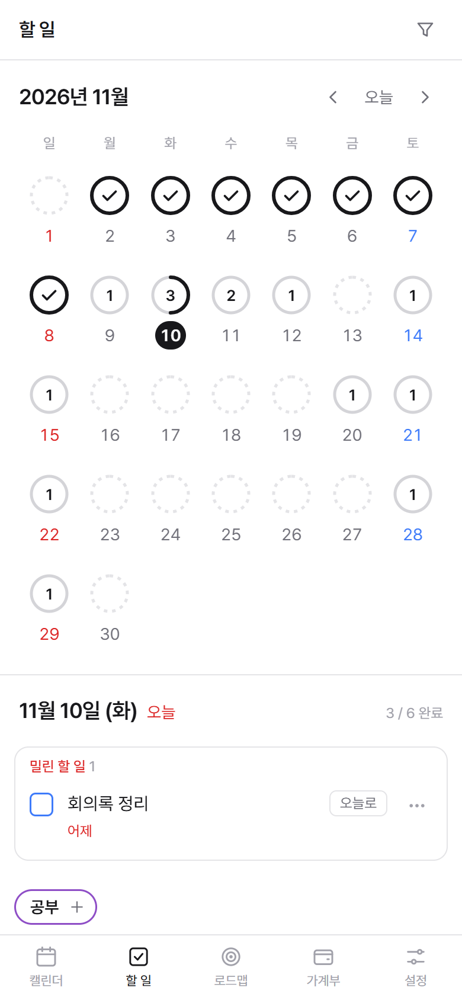
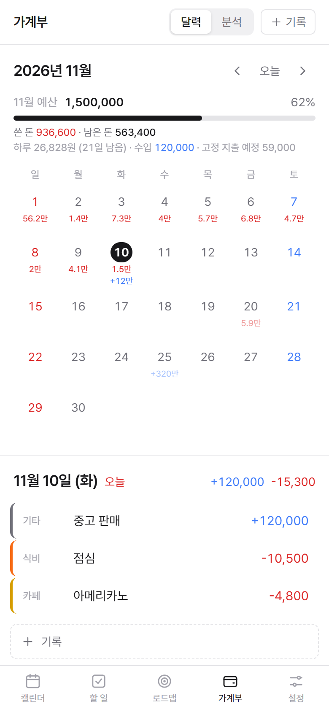

# Daypath

**하루하루가 목표로 이어지는 길.** 일정, 할 일, 목표 로드맵, 가계부를 한곳에서 관리하는 개인용 PWA입니다.

[](https://nextjs.org)
[](https://react.dev)
[](https://tailwindcss.com)
[](https://supabase.com)
[](https://daypath-ten.vercel.app)

**[daypath-ten.vercel.app](https://daypath-ten.vercel.app)** · PC, 맥북, 아이패드, 휴대폰에서 같은 데이터로



## 무엇을 하나요

- **캘린더**: 일·주·월 보기, 드래그로 옮기고 길이 조절, 종일·여러 날 일정, 반복 일정(매일·매주 요일·매달·매년, 이 일정만 / 이후 / 전체 수정)
- **할 일**: 날짜별 목록을 카테고리별로 묶어서 보기. 미니 달력에 날마다 진행률 링이 있고, 밀린 할 일은 따로 모아 "오늘로"
- **로드맵**: 목표 → 마일스톤 → 할 일로 나눠 진행률을 자동으로 계산. D-day, 월·분기·연 타임라인, 보관함
- **가계부**: 달력에 하루 지출·수입, 월 예산과 남은 돈, 매달 자동으로 기록되는 고정 지출·수입, 분류별 원그래프
- **알림**: Web Push. 일정마다 여러 시점 알림, 종일 일정 알림, 정해 둔 시각에 그날 할 일 묶음 알림
- **동기화**: Supabase 실시간 구독으로 기기 사이 바로 반영. 설정 없이 켜면 브라우저 안에만 저장하는 로컬 모드

색은 칠하지 않고 테두리로 구분하는 미니멀한 화면에 라이트·다크 모드, 24시간제, 일요일 시작 달력을 씁니다.

## 화면

<table>
  <tr>
    <td width="50%"><br><sub><b>할 일</b>: 진행률 링 달력과 카테고리별 목록</sub></td>
    <td width="50%"><br><sub><b>로드맵</b>: 목표, 마일스톤, 연결된 할 일</sub></td>
  </tr>
  <tr>
    <td><br><sub><b>가계부</b>: 예산, 하루 합계, 흐리게 보이는 고정 지출 예정</sub></td>
    <td><br><sub><b>가계부 분석</b>: 분류별 원그래프</sub></td>
  </tr>
</table>

<p>
  
  &nbsp;
  
</p>

## 기술 스택

| 영역 | 사용 |
|---|---|
| 프레임워크 | Next.js 16 (App Router, Cache Components), React 19, TypeScript |
| 화면 | Tailwind CSS 4, FullCalendar 7, next-themes |
| 데이터 | Supabase (Postgres, Auth, RLS, Realtime) / 로컬 모드는 localStorage |
| 알림 | Web Push (VAPID) + 서비스 워커, Supabase pg_cron이 1분마다 발송 API 호출 |
| 배포 | Vercel (main에 push하면 자동 배포), PWA 설치 |

데이터는 저장소 인터페이스 하나 뒤에 로컬 / Supabase 두 구현을 두고, 화면은 낙관적 업데이트로 먼저 바뀐 뒤 저장합니다. 반복 일정과 가계부 고정 항목은 서버 작업 없이 앱에서 계산합니다(고정 항목 자동 기록은 항목과 달로 id를 정해 여러 기기에서 동시에 만들어도 하나만 남습니다).

## 시작하기

Node.js 20.9 이상(권장 24, `.nvmrc`)이 필요합니다. Windows와 macOS에서 똑같이 실행됩니다.

```bash
npm install
npm run dev
```

http://localhost:3000 에서 열립니다. `.env.local`이 없으면 **로컬 모드**로 동작해서 데이터가 이 브라우저에만 저장됩니다.

### Supabase 연결 (기기 간 동기화)

1. [supabase.com](https://supabase.com)에서 새 프로젝트를 만듭니다.
2. **SQL Editor**에서 [supabase/schema.sql](supabase/schema.sql)을 실행하고, 이어서 [supabase/migrations/](supabase/migrations/)의 파일을 번호 순서대로 실행합니다.
3. `.env.example`을 복사해 `.env.local`을 만들고 **Project Settings → API**의 Project URL과 Publishable key를 채웁니다.
4. 개발 서버를 다시 시작하면 로그인 화면이 나옵니다.

이미 쓰고 있는 Supabase 프로젝트로 다른 PC에서 이어서 작업할 때는 `.env.local`만 만들면 됩니다. 알림 키 설정과 현재 운영 상태는 [SPEC 10장](docs/SPEC.md#10-다른-pc에서-이어서-작업하기)에 있습니다.

### 확인 명령

```bash
npx next typegen   # 처음 한 번: 라우트 타입 생성
npx tsc --noEmit   # 타입 검사
npx eslint src     # 린트
npx next build     # 프로덕션 빌드
```

## 폴더 구조

```
src/
  app/(main)/          캘린더 · 할 일 · 로드맵 · 가계부 · 설정 화면
  app/api/push/        알림 발송 (pg_cron이 1분마다 호출)
  app/manifest.ts      PWA manifest
  components/          앱 틀(사이드바 / 하단 탭), 로그인, 서비스 워커 등록
    calendar/          캘린더
    tasks/             할 일 탭
    roadmap/           로드맵 목록 · 상세 · 타임라인
    money/             가계부 달력 · 분석 · 기록 창 · 고정 항목
    editor/            일정 · 할 일 편집 창
    settings/          테마, 카테고리 · 태그 · 가계부 분류, 알림
  lib/data/            저장소(로컬 / Supabase), 전역 상태
  lib/                 타입, 날짜, 반복 규칙, 로드맵 진행률, 가계부 계산
supabase/              schema.sql + migrations/ (번호 순서)
scripts/               아이콘 PNG 생성, 알림 키 생성
docs/SPEC.md           기획 · 화면 규칙 · 결정 기록 · 운영 상태
```

데이터 흐름과 새 테이블을 추가할 때 고칠 곳은 [SPEC 10.4](docs/SPEC.md#104-코드-구조와-데이터-흐름)에 있습니다.

## 진행 상황

- [x] 1단계: 일정 CRUD, 카테고리 · 태그, 일 / 주 / 월 보기, 드래그, 다크 모드, 로그인 · 동기화
- [x] 2단계: 할 일 탭, 카테고리 · 태그 필터 (이후 캘린더와 할 일 분리)
- [x] 3단계: 반복 일정, PWA 설치, Vercel 배포, Web Push 알림
- [x] 4단계: 로드맵 (목표 → 마일스톤 → 할 일, 진행률, 보관함, 타임라인)
- [x] 5단계: 가계부 (기록 · 달력 · 월 예산, 고정 지출 · 수입 자동 기록, 분류별 분석)

자세한 기획과 결정 기록은 [docs/SPEC.md](docs/SPEC.md)에 있습니다.

<sub>README 스크린샷은 로컬 모드의 예시 데이터로 찍었습니다.</sub>
